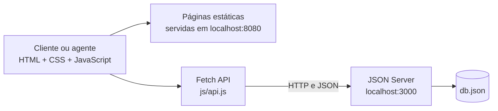

# DriveOn — Sistema de aluguel de carros

> Protótipo acadêmico para solicitar e acompanhar aluguéis de automóveis, analisar pedidos e registrar contratos.

<p align="center"></p>


---

## 📚 Índice

- [Links úteis](#-links-úteis)
- [Sobre o projeto](#-sobre-o-projeto)
- [Funcionalidades principais](#-funcionalidades-principais)
- [Tecnologias utilizadas](#-tecnologias-utilizadas)
- [Arquitetura](#-arquitetura)
- [Instalação e execução](#-instalação-e-execução)
- [Deploy](#-deploy)
- [Estrutura de pastas](#-estrutura-de-pastas)
- [Demonstração](#-demonstração)
- [Testes](#-testes)
- [Documentações utilizadas](#-documentações-utilizadas)
- [Autor](#-autor)
- [Contribuição](#-contribuição)
- [Agradecimentos](#-agradecimentos)
- [Licença](#-licença)

---

## 🔗 Links úteis

- **Demonstração online:** não há uma versão publicada. Consulte [como executar localmente](#-instalação-e-execução).
- **Documentação e modelagem:** [docs/modelagem.md](docs/modelagem.md), com casos de uso, histórias de usuário, diagramas de classes, pacotes e componentes.
- **Repositório:** [Locadora-de-Carros no GitHub](https://github.com/gustavonmsouza/Locadora-de-Carros).

---

## 📝 Sobre o projeto

DriveOn é um protótipo acadêmico da disciplina Desenvolvimento de Interfaces Web. Ele demonstra o processo de aluguel de carros pela web: o cliente consulta a frota, envia um pedido com período e dados financeiros, e agentes de empresas e bancos analisam a solicitação. Quando aprovado, o pedido pode ser convertido em contrato.

O sistema usa páginas HTML dinâmicas no navegador e persiste os dados em `db.json` por meio do JSON Server. É um ambiente didático, sem autenticação segura ou serviço de produção.

---

## ✨ Funcionalidades principais

- Catálogo de automóveis com busca por marca ou modelo e filtro por disponibilidade no período.
- Cadastro e login de clientes, empresas e bancos.
- Perfil de cliente com CPF, RG, endereço, profissão e até três fontes de rendimento; consulta, edição e exclusão do cadastro.
- Criação, consulta, edição e cancelamento de pedidos; validação de datas e conflitos de período.
- Painel dos agentes para consultar e modificar pedidos em aberto, revisar dados financeiros e registrar pareceres de avaliação.
- Solicitação de crédito a um banco e registro da concessão por um agente bancário.
- Execução de pedidos aprovados, com geração de contrato e atualização da disponibilidade do veículo.
- Registro separado do proprietário do automóvel e do banco que concedeu crédito.
- Visualização e impressão do contrato pelo navegador, incluindo salvamento em PDF.

---

## 🛠 Tecnologias utilizadas

### Front-end

- HTML5 e CSS3.
- JavaScript Vanilla (ES6+), com Fetch API.
- Bootstrap 5.3.3, carregado pela CDN jsDelivr.

### API e persistência

- Node.js e npm.
- JSON Server 0.17.4, como API REST simulada.
- `db.json` como persistência local.

### Infraestrutura

- Um servidor local para o JSON Server e outro para servir as páginas estáticas.
- Não há variáveis de ambiente. A URL da API está definida em `js/api.js` como `http://localhost:3000`.
- O Bootstrap, as fontes e algumas imagens são carregados de serviços externos; é necessária conexão à internet para esses recursos.

---

## 🏗 Arquitetura

O protótipo separa a apresentação em páginas HTML, a lógica em arquivos JavaScript por fluxo e a persistência numa API REST local. A escolha mantém o projeto pequeno e permite demonstrar Fetch API, renderização dinâmica e operações CRUD sem implementar um back-end próprio.



O detalhamento dos módulos e dos modelos está em [docs/modelagem.md](docs/modelagem.md). A API organiza os dados nas coleções `usuarios`, `clientes`, `automoveis`, `pedidos` e `contratos`.

---

## 🔧 Instalação e execução

### Pré-requisitos

- Node.js 18 ou superior e npm.
- Navegador atualizado.
- Conexão à internet para carregar Bootstrap, fontes e imagens externas.

### Instalar dependências

Na raiz do projeto:

```bash
npm ci
```

### Iniciar a API

No primeiro terminal:

```bash
npm start
```

O JSON Server ficará disponível em `http://localhost:3000`.

### Servir as páginas

No segundo terminal, ainda na raiz do projeto:

```bash
npx --yes http-server . -p 8080
```

Abra `http://localhost:8080/index.html`. Use uma origem HTTP; abrir `index.html` diretamente pelo protocolo `file://` não funciona com a API.

### Contas demonstrativas

| Perfil | E-mail | Senha |
|---|---|---|
| Cliente | `marcos@email.com` | `123` |
| Agente bancário | `banco@alvorada.com` | `123` |
| Agente de empresa | `contato@tresmarias.com` | `123` |

Os dados são fictícios e servem apenas para demonstração. O JSON Server grava alterações em `db.json`; restaure uma cópia desse arquivo para reiniciar os dados de exemplo.

---

## 🚀 Deploy

Não há deploy configurado. O JSON Server e a autenticação atual servem para demonstração local e não devem ser expostos como serviço de produção.

---

## 📂 Estrutura de pastas

```text
.
├── index.html          # Página inicial, catálogo, login e cadastro
├── frota.html          # Catálogo de veículos para clientes autenticados
├── detalhes.html       # Detalhes do automóvel e solicitação
├── cliente.html        # Perfil e pedidos do cliente
├── agente.html         # Análise, crédito e contratos
├── contrato.html       # Documento de contrato para impressão
├── css/
│   └── style.css       # Estilos da aplicação
├── assets/
│   └── car-placeholder.svg # Imagem local de reserva para veículos sem foto
├── js/
│   ├── api.js          # Fetch, sessão e utilitários compartilhados
│   ├── auth.js         # Login e cadastro
│   ├── home.js         # Catálogo e busca
│   ├── details.js      # Detalhes e solicitação de aluguel
│   ├── cliente.js      # Perfil e pedidos do cliente
│   ├── agente.js       # Edição e avaliação de pedidos, crédito e contratos
│   ├── agente 2.js     # Cópia local antiga, não referenciada pelas páginas
│   └── contrato.js     # Renderização do documento
├── docs/
│   ├── logo.svg        # Logo DriveOn
│   └── modelagem.md    # Histórias de usuário e diagramas Mermaid
├── db.json             # Dados locais do JSON Server
├── package.json        # Script de inicialização e dependências
└── package-lock.json   # Versões travadas das dependências
```

---

## 🎥 Demonstração

Não há capturas de tela ou vídeo incluídos. Para explorar o protótipo, entre com uma das contas demonstrativas, selecione um veículo, envie um pedido, avalie-o no painel de agente e visualize o contrato após a aprovação.

Exemplo de leitura de um automóvel pela API:

```bash
curl http://localhost:3000/automoveis/2
```

Resposta de exemplo:

```json
{
  "id": 2,
  "matricula": "MAT-0002",
  "ano": 2023,
  "marca": "Chevrolet",
  "modelo": "Onix Plus",
  "imagem": "https://thumb.wikimedia.org/wikipedia/commons/thumb/c/c8/2021_Chevrolet_Onix_Plus_1.2_LT.jpg/960px-2021_Chevrolet_Onix_Plus_1.2_LT.jpg",
  "imagemAutor": "Just_a_Man",
  "imagemLicenca": "CC BY 4.0",
  "imagemFonte": "https://commons.wikimedia.org/wiki/File:2021_Chevrolet_Onix_Plus_1.2_LT.jpg",
  "placa": "QWE4F56",
  "proprietario": "empresa",
  "proprietarioNome": "Locadora Três Marias",
  "disponivel": true
}
```

---

## 🧪 Testes

Não há scripts de teste automatizado no `package.json`. Foi feita verificação manual ponta a ponta no Chrome, usando uma cópia temporária do banco: cadastro e exclusão de contas, perfil, pedidos, filtros e conflitos de datas, análise de empresa e banco, concessão de crédito, execução e visualização de contratos, validações de formulário e mensagens de falha da API.

---

## 🔗 Documentações utilizadas

- [Bootstrap 5](https://getbootstrap.com/docs/5.3/)
- [JSON Server](https://github.com/typicode/json-server/tree/v0.17.4)
- [Fetch API — MDN](https://developer.mozilla.org/docs/Web/API/Fetch_API)
- [Node.js](https://nodejs.org/docs/)
- [Modelagem do DriveOn](docs/modelagem.md)
- Enunciado do Laboratório 02 — arquivo fornecido pela disciplina, não incluído neste repositório.

---

## 👤 Autor

| Nome | GitHub |
|---|---|
| Gustavo Norberto | [@gustavonmsouza](https://github.com/gustavonmsouza) |