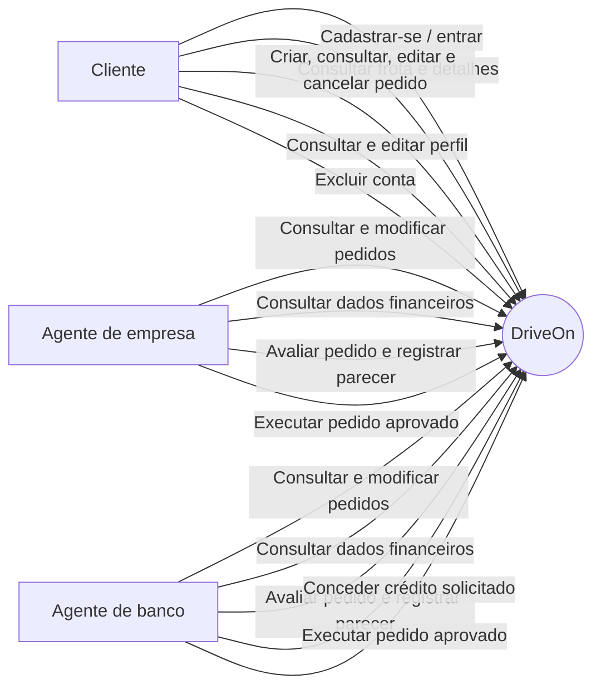
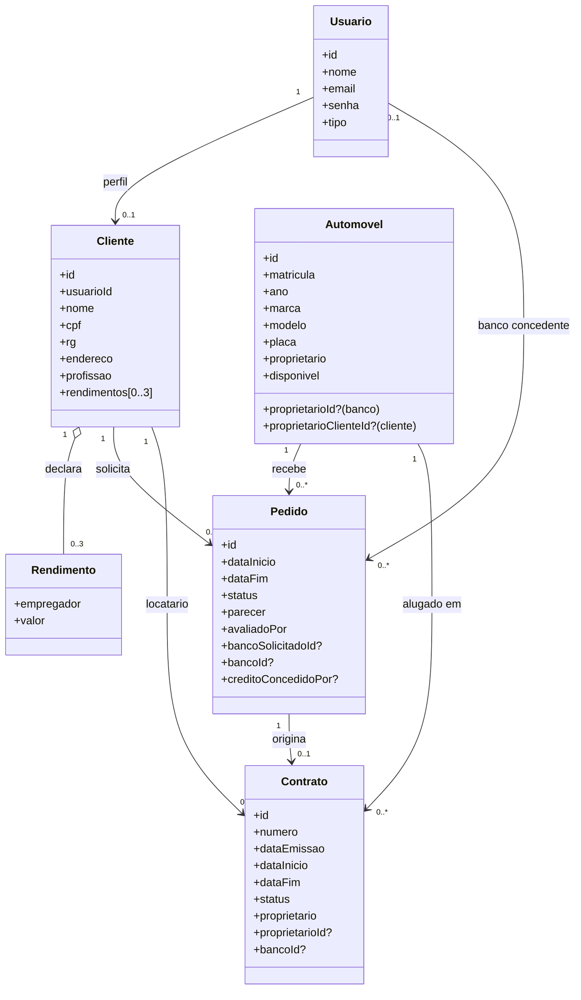
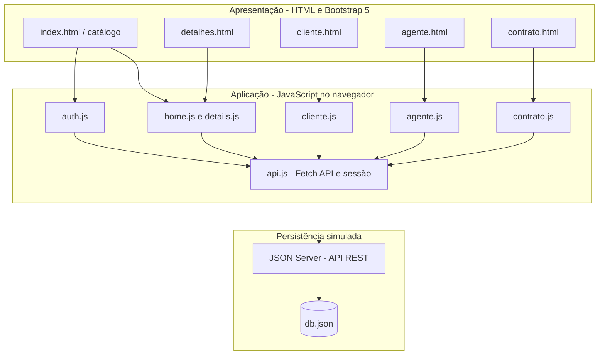
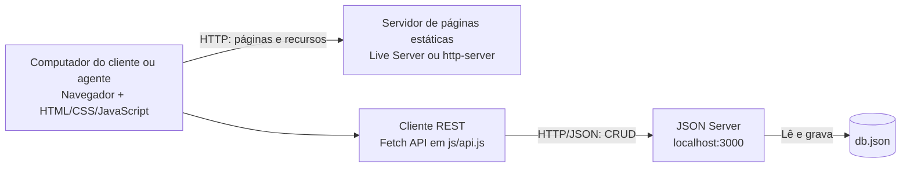

# Modelagem do DriveOn

Modelagem do protótipo do Laboratório 02. Os diagramas usam Mermaid para permanecerem editáveis junto ao código e documentam os fluxos e as entidades implementados no DriveOn.

## Casos de uso

## Histórias do usuário

- Como cliente, quero criar uma conta com meus dados de identificação e até três fontes de renda para solicitar aluguéis.
- Como cliente, quero pesquisar veículos, informar um período e acompanhar o status do meu pedido.
- Como cliente, quero editar ou cancelar pedidos ainda em análise e atualizar ou excluir meu cadastro.
- Como agente de empresa ou banco, quero consultar os dados do cliente e avaliar o pedido com um parecer para registrar uma decisão financeira.
- Como agente de empresa ou banco, quero ajustar o veículo, o período e o banco solicitado de um pedido em aberto para corrigir seus dados antes da análise.
- Como agente bancário, quero conceder o crédito solicitado para que ele conste no contrato executado.
- Como agente, quero executar um pedido aprovado e gerar um contrato associado ao veículo, cliente e período.

## Diagrama de classes

`Usuario.tipo` assume `cliente`, `empresa` ou `banco`. `Automovel.proprietario` assume `cliente`, `empresa` ou `banco`; quando o proprietário é cliente, `proprietarioClienteId` referencia o cadastro de cliente. O banco solicitado no pedido é separado do banco que efetivamente concedeu o crédito.

## Diagrama de pacotes (visão lógica)

## Diagrama de componentes

## Decisões e alinhamento com o código

- A interface está separada por fluxo: catálogo e detalhes públicos, painel do cliente, painel dos agentes e documento do contrato.
- `js/api.js` concentra chamadas Fetch, sessão local e funções comuns de apresentação; os demais scripts implementam seus respectivos fluxos.
- `db.json` contém as coleções `usuarios`, `clientes`, `automoveis`, `pedidos` e `contratos`, consumidas como recursos REST pelo JSON Server.
- `bancoSolicitadoId` registra a opção do cliente; `bancoId` junto de `creditoConcedidoPor` registra a concessão do banco.
- Agentes podem alterar veículo, período e banco solicitado enquanto o pedido estiver `Em análise` ou `Aprovado`. Toda alteração volta o pedido para `Em análise` e limpa parecer e crédito concedido para exigir nova avaliação.
- O contrato copia os dados de propriedade do automóvel. A execução altera a disponibilidade do veículo, sem confundir propriedade com crédito.
- As regras e a autenticação são demonstrativas e ficam no cliente; JSON Server não oferece autorização segura para uso em produção.
